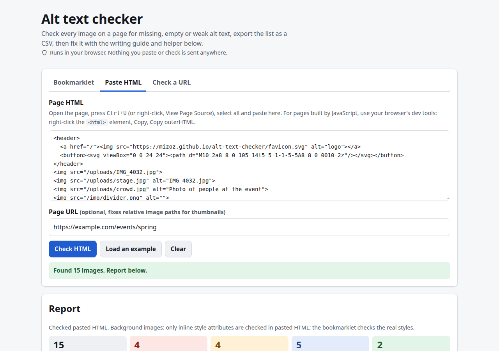

# Alt Text Checker

**Live:** https://mizoz.github.io/alt-text-checker/



I built this because every time I checked an event or campaign page for accessibility, I ended up opening dev tools and hunting through `` tags by hand. Half the alt text was `IMG_4032.jpg`, the other half was `image`, and a few icon links had nothing at all. This finds those in a couple of seconds.

## What it does

- **Bookmarklet.** Drag it to your bookmarks bar, click it on any page. A panel lists every image with errors, warnings and notes. "Show on page" scrolls to the image and outlines it. Download the list as a CSV.
- **Paste HTML.** Paste a page's source and get the same report, with thumbnails when image paths are absolute (or when you give it the page URL).
- **Check a URL.** Tries to fetch the page directly. Most sites block this (CORS), and the tool tells you so instead of pretending.
- **Alt text helper.** A short form that asks what the image is doing on the page and drafts alt text from your answers. No image recognition; you know the context, a machine doesn't.
- **Guide.** Good and bad examples for decorative, informative and functional images, logos, charts and text in images, plus a plain-language summary of WCAG 2.2 SC 1.1.1.

What it flags: missing alt, empty alt (fine if it's decoration), file-name alt, generic alt ("image", "photo", "logo"), "image of..." prefixes, alt over 125 characters, the same alt on different images, alt that repeats the link text or caption, image-only links and buttons with no name, image buttons and map areas with no text, unnamed inline SVGs, `role="img"` with no label, tiny tracking pixels, and CSS background images (which can't have alt at all).

It can't tell you whether a description is *good*. That's still a human job.

## Privacy

Everything runs in your browser. There's no server, no account, no analytics, no cookies. The bookmarklet only reads the page you run it on and doesn't send anything anywhere. Report thumbnails load straight from wherever the images are hosted; you can switch them off. Your last inputs are saved in your browser's localStorage so they're still there next time.

## How it works

`audit.js` has the checks. The same functions are turned into the bookmarklet (stringified and URL-encoded) and used by the paste and URL modes (via `DOMParser`, so pasted scripts never run). The bookmarklet panel lives in a shadow root so the page's CSS doesn't mess with it.

## Run locally

```
python3 -m http.server
```

Then open http://localhost:8000. No build step, no dependencies.

## Sources

Last checked 2026-10-21.

- WCAG 2.2, SC 1.1.1 Non-text Content: https://www.w3.org/TR/WCAG22/#non-text-content
- Understanding SC 1.1.1: https://www.w3.org/WAI/WCAG22/Understanding/non-text-content.html
- W3C images tutorial and alt decision tree: https://www.w3.org/WAI/tutorials/images/decision-tree/
- HTML spec, requirements for providing text to act as an alternative for images: https://html.spec.whatwg.org/multipage/images.html#alt

WCAG doesn't set a length limit for alt text. The 125-character warning is a common rule of thumb, not a rule, and the page says so.

## License

MIT. See [LICENSE](LICENSE).
